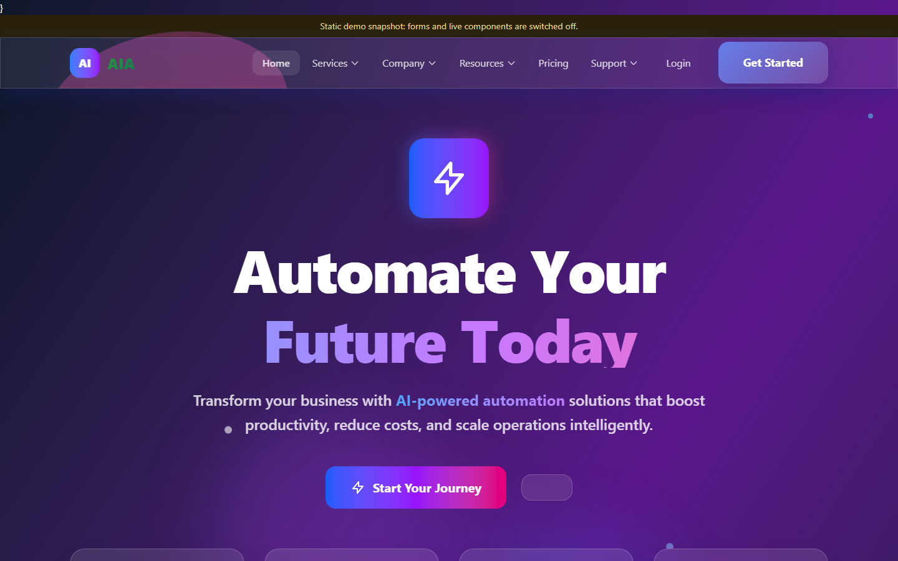
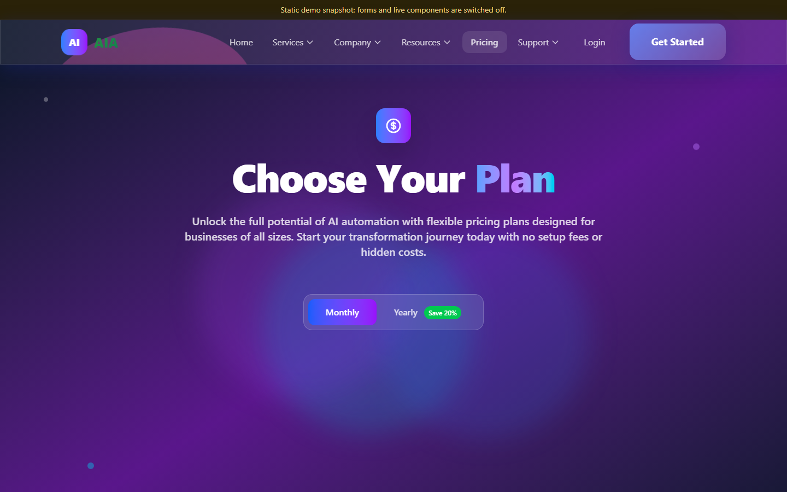

<div align="center">

# AIA · AI Automation Agency

**A modular Laravel platform for an AI automation agency: services, solutions, portfolio, pricing, blog and an admin area.**

[](https://faisalalghates.github.io/AIA/)


**[Live demo](https://faisalalghates.github.io/AIA/)** · [Pages](#pages) · [Run it](#run-it) · [Architecture](#architecture)



</div>

> **About the demo.** The live demo is a read-only static snapshot of the running app (a CI job boots Laravel with the seeded data and saves the pages). Forms and live components do not work in it. Run the project locally for the real thing.

## What it is

AIA is the web presence of an AI and automation agency: a public site that explains what the agency does and what it costs, and an admin area that keeps the content up to date.

## Pages

| Page | Purpose |
| --- | --- |
| Home | Hero, value proposition and calls to action |
| Solutions and Services | What the agency builds and how it is delivered |
| Portfolio and Team | Past work and the people behind it |
| Pricing | Plans with a monthly and yearly toggle and a feature comparison |
| Blog, Resources, Documentation, FAQ | Content hub and self-service help |
| Analytics | Traffic and engagement overview |
| Support and Legal | Contact and policies |
| Admin | Manage services and team members |
| Account | Registration, login, profile and appearance settings |



## Tech stack

- **Backend:** PHP 8.2+, Laravel 12, Livewire with Volt and Flux
- **Architecture:** modular, using `nwidart/laravel-modules` and Laravel Modules Livewire
- **Frontend:** Blade, Tailwind CSS 4, Vite
- **Data:** SQLite by default, any Laravel-supported database works
- **Quality:** Pest, Laravel Pint

## Run it

You need PHP 8.2+, Composer and Node.js.

```bash
git clone https://github.com/FaisalAlghates/AIA.git
cd AIA

composer install
npm install

cp .env.example .env
php artisan key:generate
touch database/database.sqlite

php artisan migrate --seed
```

Then, in two terminals:

```bash
php artisan serve
npm run dev
```

Open <http://127.0.0.1:8000>. Run the tests with `php artisan test`.

## Architecture

Each business area (Home, Solutions, Services, Blog, Documentation, Pricing, Analytics, Automation Hub, Portfolio, Team, Resources, Support, Legal) lives in its own module with its controllers, views and routes, so a feature can be changed or removed without touching the rest.

## License

MIT.
